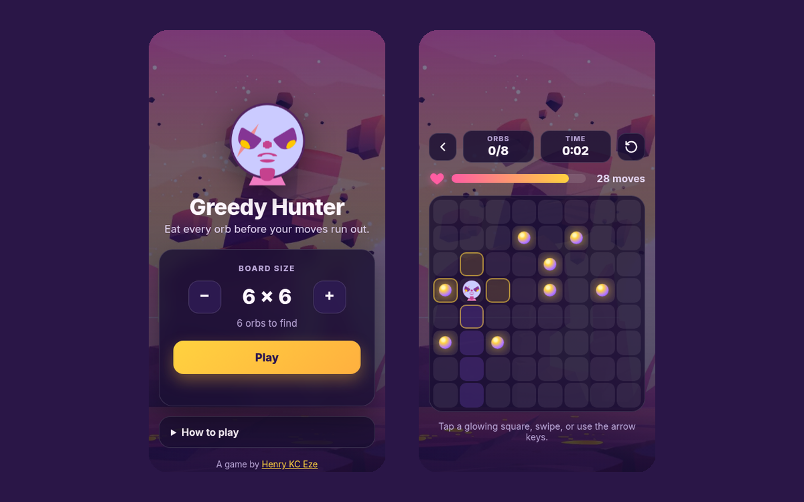

# Greedy Hunter

A puzzle game: eat every orb on the board before your moves run out.

**[Play it](https://henrykc24.github.io/greedy-hunter-game/)**

## How to play

- Choose a board from 5 × 5 to 12 × 12. A board has as many orbs as it has rows.
- Move one square at a time: tap a glowing square next to the hunter, swipe, or use the arrow keys (or W A S D).
- The energy bar shows the moves you have left. Every board can be won: the moves allowed are never fewer than a nearest-orb-first route.
- Your best time for each board size is kept in your browser.

## Built with

HTML, CSS and JavaScript, no framework and no build step. Works on phones and desktops, with keyboard and screen-reader support.

The first version (2021) was built in React from a recruiter's Figma designs; it is in this repository's history.

## Author

**Henry KC Eze** · [Website](https://henrykc24.github.io/my-portfolio/) · [GitHub](https://github.com/HENRYKC24) · [LinkedIn](https://linkedin.com/in/henry-kc)

## License

[MIT](./LICENSE)
